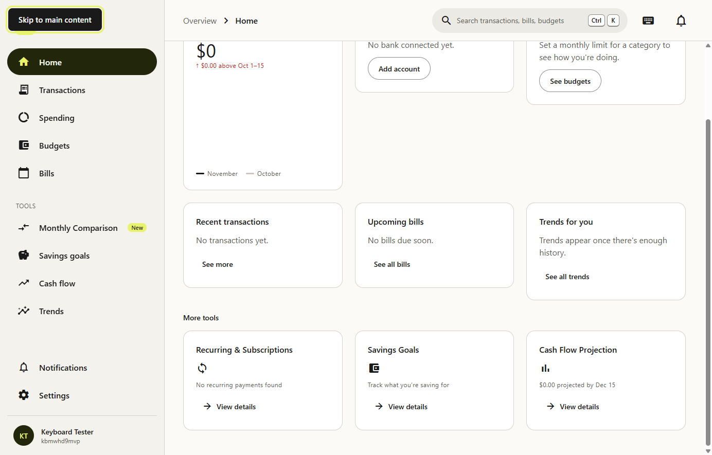
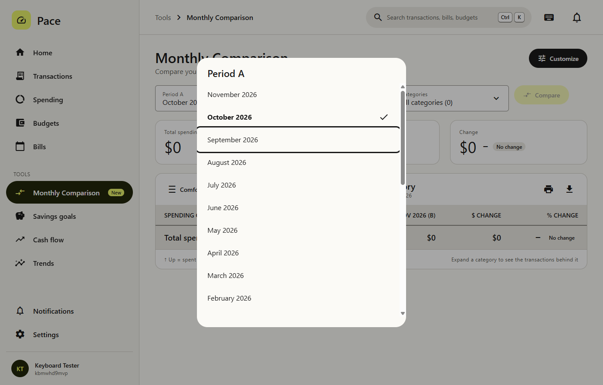
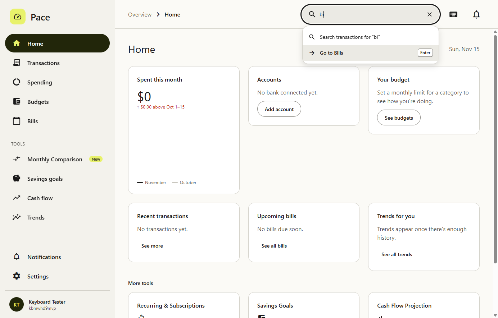
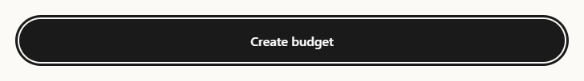
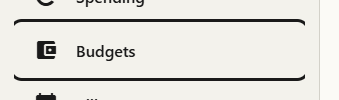
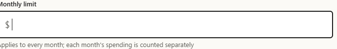

# Keyboard-only testing checklist: Pace desktop (Electron)

**Tested:** 14–15 November 2026, Windows 11, Electron 45, on the final build of branch `electron`
**Result:** all **284 checks pass** after the fixes listed under [Problems found and fixed](#problems-found-and-fixed). The first runs found 10 keyboard problems.

## How it was tested

- **Keyboard only.** Every action was a key press (Tab, Shift+Tab, arrow keys, Home/End, Enter, Space, Esc, shortcut combinations) or typed text. The mouse was never used. A script sent the keys to the running Electron app through its DevTools connection. The script only *read* the page (which control has focus, its outline, its position, the URL) and never clicked or moved focus itself.
- **Every view.** All 11 sidebar pages, every sub-page and form, every dialog, picker and panel, and the signed-out pages (sign in, create account, forgot password, onboarding, connect bank). Each view was audited as follows:
  - Tab all the way round, recording every focus stop, until focus came back to the first one.
  - Shift+Tab all the way round in the other direction.
  - Check that every control that should take focus was reached.
  - At every stop, check that the focus indicator is visible and the control is on screen and not covered.
- **Real tasks.** Signing in and out, creating an account and going through onboarding, adding a budget and a savings goal, setting a date, choosing a security question, searching, opening the filters, opening rows, ticking categories, adding a note, and changing settings.
- **Test data.** A copy of the app's data was used, so the real database was untouched. Native Save dialogs (for example Ctrl+P → save as PDF) were recorded and cancelled instead of shown, because the test can't press keys in a system window.

---

## 1. Can everything be reached and used?

- [x] Every control on every view is reached with Tab. No view had a control that Tab missed.
- [x] Every page can be opened from the keyboard: sidebar links with Enter, Ctrl+1 … 9 and Ctrl+, shortcuts, search, the breadcrumb, and Enter or Space on rows and cards.
- [x] Every task listed under [How it was tested](#how-it-was-tested) can be finished with the keyboard alone.
- [x] Disabled or unfinished features still respond to the keyboard. "Choose dates" (Spending) and "Theme" (Settings) aren't built yet; Enter on them shows the same "not implemented yet" notice as a click.

| View | Tab stops | Result |
| --- | ---: | --- |
| Sign in | 6 | ✅ |
| Home | 40 | ✅ |
| Transactions | 69 | ✅ |
| Spending | 26 | ✅ |
| Budgets | 26 | ✅ |
| Bills | 30 | ✅ |
| Monthly Comparison | 30 | ✅ |
| Savings goals | 23 | ✅ |
| Cash flow | 19 | ✅ |
| Trends | 17 | ✅ |
| Notifications | 20 | ✅ |
| Settings | 30 | ✅ |
| Transaction detail | 36 | ✅ |
| Spending category | 22 | ✅ |
| Budget category | 20 | ✅ |
| Bill detail | 23 | ✅ |
| Manage recurring bills | 33 | ✅ |
| Manage budgets | 31 | ✅ |
| Budget form | 21 | ✅ |
| Bill form | 25 | ✅ |
| Goal form | 23 | ✅ |
| Expected income form | 21 | ✅ |
| Profile | 25 | ✅ |
| Connected accounts | 32 | ✅ |
| Add account | 19 | ✅ |
| Statements | 22 | ✅ |
| Forgot password (both steps) | 4 + 8 | ✅ |
| Create account | 14 | ✅ |
| Onboarding | 9 | ✅ |
| Connect bank | 4 | ✅ |
| Keyboard shortcuts dialog | 3 | ✅ |
| Customize panel / Categories (Monthly Comparison) | 18 | ✅ |
| Period A / B picker | 1 (↑ ↓ inside) | ✅ |
| Transaction filters: date, account, category | 1 each (↑ ↓ inside) | ✅ |
| Bill reminders picker | 1 (↑ ↓ inside) | ✅ |
| Bill options menu (⋮) | 1 (↑ ↓ inside) | ✅ |
| Delete account dialog (cancelled) | 2 | ✅ |

*Pages show the sidebar and top bar too, so their counts include those 16 stops (17 where the breadcrumb is a link).*

## 2. Keys

### Tab and Shift+Tab
- [x] Tab moves forward through every control in reading order: sidebar, then top bar, then page.
- [x] Shift+Tab visits exactly the same controls in exactly the reverse order, on every view.
- [x] A group of options (radio buttons, tabs, a picker's list) is **one** Tab stop. Tab enters on the chosen option and leaves the group in one step.
- [x] Search results are not Tab stops. Tab from the search box goes on to the next control.
- [x] **Skip link:** the first Tab stop is "Skip to main content". It appears when focused, and Enter on it moves focus to the page, so Tab continues there.

### Arrow keys
- [x] ← → choose in the radio groups: Spending period, Bills view, Cash flow projection and scenario. ↑ ↓ also work.
- [x] Home and End jump to the first and last option of a group.
- [x] ← → move between the tabs of the Customize panel.
- [x] ↑ ↓ move through the options of every picker (periods, filters, reminders, security question, bill options).
- [x] ↑ ↓ move the highlighted result in search, while focus stays in the box.
- [x] In a date field, ↑ ↓ change the selected part of the date (day, month or year).

### Enter
- [x] Enter presses every button, opens every row and card, follows every link (sidebar, breadcrumb, skip link) and chooses the highlighted option in a picker.
- [x] Enter in the sign-in form signs in, and Enter in a date field sets the date.
- [x] Enter on a search result opens it. With text typed, Enter searches transactions for it.

### Space
- [x] Space ticks checkboxes (a transaction's categories) and toggles switches (Settings), and the page doesn't scroll.
- [x] Space presses buttons and opens rows, the same as Enter.

### Escape
- [x] Esc closes every dialog, picker and panel: shortcuts list, Customize, period / filter / reminder pickers, bill options, delete-account dialog, note dialog.
- [x] After Esc, **focus goes back to the control that opened it**. This was checked for every pop-up.
- [x] Esc in search clears it and moves focus to the page.
- [x] Esc in a date field cancels the edit and returns focus to the field.
- [x] Esc in a form field does **not** throw away the form.

## 3. Keyboard shortcuts

| Shortcut | Checked | Result |
| --- | --- | --- |
| Ctrl+1 … Ctrl+9 | Each opens Home, Transactions, Spending, Budgets, Bills, Monthly Comparison, Savings goals, Cash flow, Trends | ✅ |
| Ctrl+, | Opens Settings | ✅ |
| Ctrl+K | Puts focus in search, with quick destinations shown | ✅ |
| Ctrl+N | Opens the new budget, bill or goal form on Budgets, Bills and Savings goals; does nothing elsewhere | ✅ |
| Ctrl+S | Saves the form (goal), also when pressed **while typing in a field**. On an empty form it shows the errors and focuses the first bad field. Where there's nothing to save it says so | ✅ |
| Ctrl+P | Opens "save as PDF" on Monthly Comparison | ✅ |
| Alt+← / Alt+→ | Back / Forward, between pages and from a detail page to its list, and also on the signed-out pages | ✅ |
| ? · Ctrl+/ · F1 | Open the keyboard shortcuts list | ✅ |
| ? while typing | Types a question mark (no dialog) | ✅ |
| Any shortcut while a dialog is open | Ignored (Ctrl+2 under the shortcuts dialog stays on the page) | ✅ |
| Shortcuts while typing | Ctrl+S and Ctrl+2 work from inside a text field | ✅ |

## 4. No keyboard traps

- [x] On every page, Tab and Shift+Tab come all the way round and never get stuck.
- [x] Every dialog, picker and panel keeps focus inside while open, as a modal dialog should. **Esc always gets out**, and focus returns to the control that opened it.
- [x] Shift+Tab inside dialogs never gets stuck. Before the fix, it stuck on the period picker's scrolling list (see below).
- [x] Text fields, the date field and search can always be left with Tab, Shift+Tab or Esc.
- [x] Signing out never leaves focus nowhere. Focus goes to the page.

## 5. Focus indicators

- [x] Every one of the **775 focus stops** visited has a visible focus indicator.
- [x] Buttons, links, rows, cards, options, chart bars and scrolling lists all get the app's **3px ring** in the theme's ink colour, offset 2px, so it shows on dark buttons too.
- [x] Text fields show focus with a thicker, darker border around the whole box.
- [x] The focused control is always on screen (it scrolls into view) and never covered by the top bar, notices or panels.

| Not focused | Focused |
| --- | --- |
|  |  |

---

## Problems found and fixed

| # | Problem found | Fix |
| --- | --- | --- |
| 1 | **Sidebar links, the skip link and the "Overview" breadcrumb didn't respond to Enter.** react-native-web leaves Enter on links to the browser, which does nothing for these elements. | Enter now presses link-role controls (`pressKeyProps` in `src/ui/keyboard.tsx`). |
| 2 | **Shortcuts didn't work while typing in a field** (Ctrl+S, Ctrl+1 …), because text fields keep their key events to themselves. | Shortcuts are also caught on the way down when focus is in a field. |
| 3 | **Shift+Tab got stuck in the period picker** (a keyboard trap). The dialog's built-in focus trap moved focus to the scrolling list itself. | Dialogs, pickers and panels now move Tab and Shift+Tab through their own controls and wrap at the ends (`tabCycleProps`). |
| 4 | **Dialogs had an invisible extra Tab stop** (the dimmed backdrop). | The backdrop can no longer take focus. |
| 5 | **After the note dialog closed, focus was lost** (it went to the page body). | Focus returns to the control that opened any dialog (`rememberFocus`). |
| 6 | **A date couldn't be typed:** the calendar pop-up took the keys, each key set a date and closed the field, and focus was lost afterwards. | From the keyboard the date field opens without the pop-up. Typing and ↑ ↓ edit the date, Enter sets it, Esc cancels, and focus returns to the field. The field's "Clear" button is no longer inside the field's button. |
| 7 | **Changing Cash flow's projection length lost focus**, because the page was swapped for a loading spinner. | The page keeps its content while the new projection loads (`keepOnChange` in `useAsyncData`). |
| 8 | **Alt+← went to Home instead of the previous page** after moving between the main sections. | Back follows your history, as in a browser. Phones keep their usual behaviour. |
| 9 | **The first search result was an extra Tab stop**, and Esc in search left focus nowhere. | Results are reached with ↑ ↓ only, and Esc moves focus to the page. |
| 10 | **Some controls only had the browser's faint 1px default focus outline** (orange, about 2:1 contrast): main buttons, chart bars, the shortcuts list, the field-style pickers. Focus was also lost after signing out, and Back didn't work on the signed-out pages. | Everything without its own focus style now gets the app's 3px ring. Focus goes to the page after signing out, and Alt+← / → work before signing in. |

New automated tests cover each fix: `keyboardDom-test.tsx`, `desktopDatePicker-test.tsx`, `journeyController-test.tsx`, `asyncData-test.tsx` and `a11yDom-test.tsx`. The full suite passes: 289 tests in 19 suites. Lint and typecheck are clean.

## Not covered by this test

- **The browser's calendar pop-up**, which only opens when a date field is clicked. It is Chromium's own control, outside the page, so key presses couldn't be sent to it. From the keyboard, dates are typed instead.
- **The macOS shortcuts** (⌘ instead of Ctrl, ⌘+[ and ⌘+] for Back and Forward). The test ran on Windows; the unit tests cover the Mac key mapping.
- **Screen readers** (keyboard behaviour only, not what is announced). The axe scan covers names and roles.
- **The phone and tablet layouts.**
- **The shortcuts list (`?`) before signing in.** It belongs to the signed-in app; only Back and Forward work on the signed-out pages.
